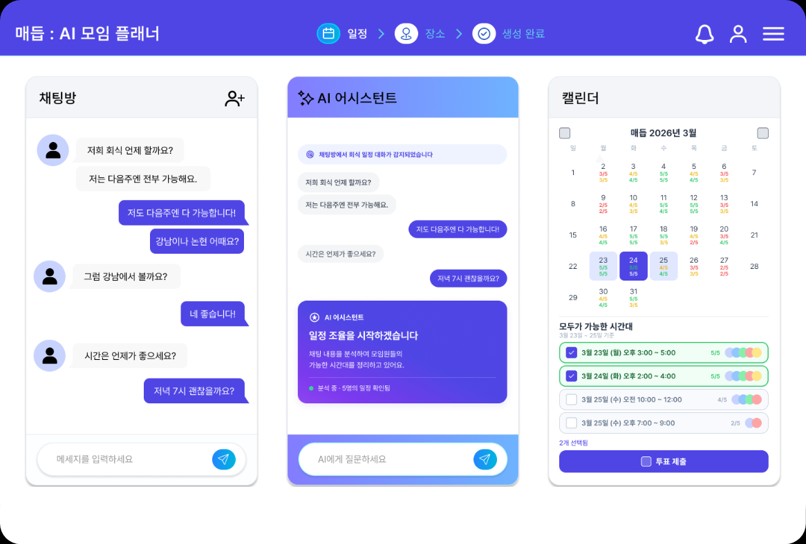
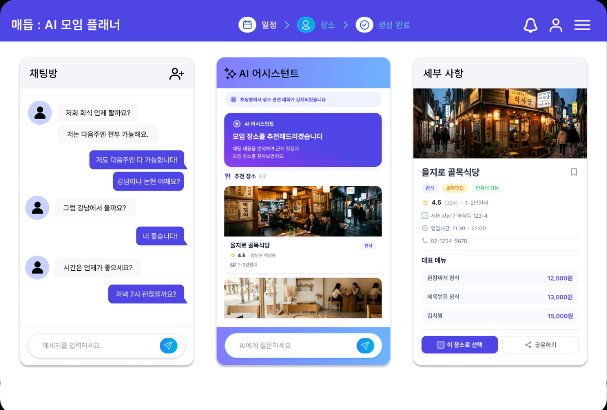
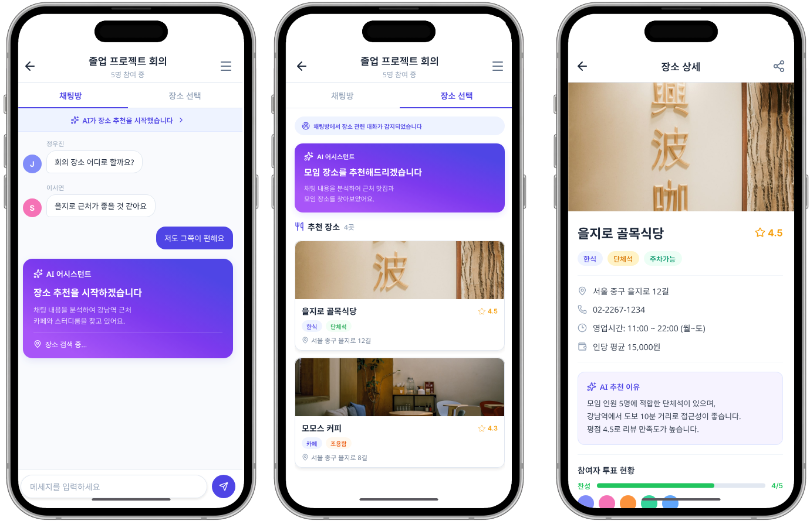
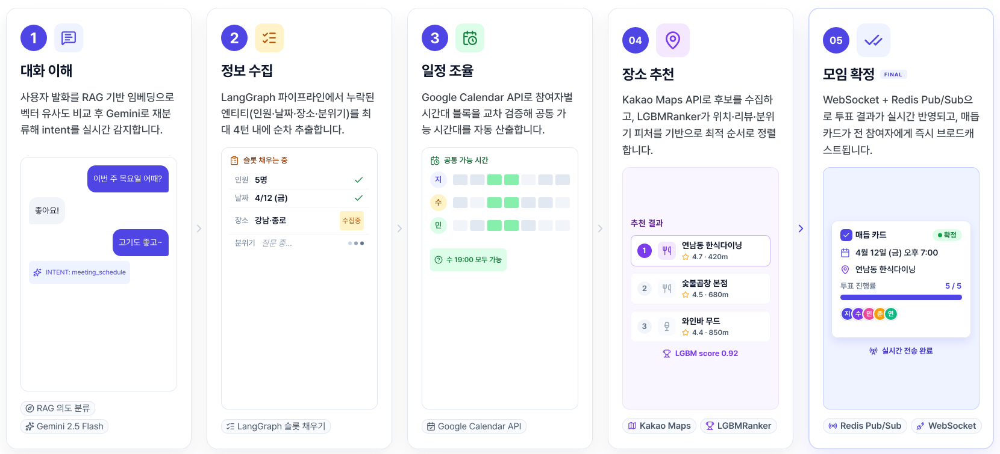

# 매듭 (Maedeup)

2026 졸업작품 · 우수상 수상

채팅방에서 모임 시간·장소가 정해지지 않고 맴도는 순간을 AI가 감지해, 투표 카드·장소 추천·확정 카드를 자동으로 띄워주는 AI 모임 조율 플랫폼입니다.

| 일정 조율 | 장소 조율 |
|---|---|
|  |  |

<p align="center"></p>

## 주요 기능
- **대화 흐름 감지**: 잡담이 모임 이야기로 넘어가거나 일정이 교착되면 AI 에이전트가 자동으로 개입
- **시간 조율**: 자연어 날짜 표현("차주 금요일 점심")을 해석하고, 멤버들의 Google Calendar 빈 시간을 바탕으로 투표 카드 생성
- **장소 추천**: 모임 유형과 인원에 맞춰 ML 랭커가 장소를 추천하고 카카오맵과 연동
- **모임 확정**: 호스트가 카드에서 바로 확정하면 캘린더에 등록되고 리마인더 발송

## AI 작동 흐름


## 기술 스택
| 영역 | 사용 기술 |
|---|---|
| Backend | FastAPI, SQLModel/SQLAlchemy(async), PostgreSQL, Redis, Alembic, APScheduler, WebSocket |
| AI | LangGraph, Gemini, RAG 기반 의도 분류, LightGBM 장소 랭커 |
| Frontend | Next.js 14, TypeScript, Tailwind CSS, PWA(TWA) |
| Infra / Test | Docker Compose, pytest(테스트 168개), Vitest, Playwright 시연 자동화 |
| 외부 연동 | Google OAuth / Calendar, Kakao Maps |

## 아키텍처
```
Next.js (PWA) ──REST/WebSocket──> FastAPI ──> LangGraph 파이프라인
                                    │          (intent → entity → slot → vote_card / place ...)
                                    ├─ PostgreSQL (모임, 방, 투표)
                                    ├─ Redis (세션, 대화 상태)
                                    └─ Gemini · Google Calendar · Kakao Maps · ML 랭커
```

## 내가 맡은 부분 — 정준영
- **LangGraph 파이프라인 구조 개선**: 단일 거대 파일이던 파이프라인을 `state.py` + 노드 10개 + `graph.py`(라우터 6개)로 분리하고, 기존 import는 re-export shim으로 유지해 무중단으로 전환
- **응답 지연 개선**
  - 자연어 날짜 파싱 메모이즈(`lru_cache`) → 호출당 약 1.5초 단축
  - 다중 날짜 entity 추출을 `asyncio.gather`로 병렬화
  - Gemini 호출에 15초 타임아웃을 걸어 최악의 지연 차단, 미팅 선호도 로딩 캐싱
- **안정성**: Redis 커넥션 누수, fire-and-forget task 누수, 에이전트 blocking 호출, KST 타임존 누락 등 실사용 관점 버그 수정
- **기능**: 방 나가기(호스트가 나가면 모임 자동 취소), 확정 완료 페이지 실데이터 연동, 슬롯 랭커 기반 투표 카드 정렬

## 실행 방법
```bash
cp backend/.env.example .env   # GEMINI_API_KEY, GOOGLE_*, KAKAO_* 등 채우기
docker compose up --build
# Frontend http://localhost:3000 · API http://localhost:8000/docs
```

## 문서
- [API 명세](docs/api-spec.md)
- [설계 결정 기록](docs/DECISIONS.md)
